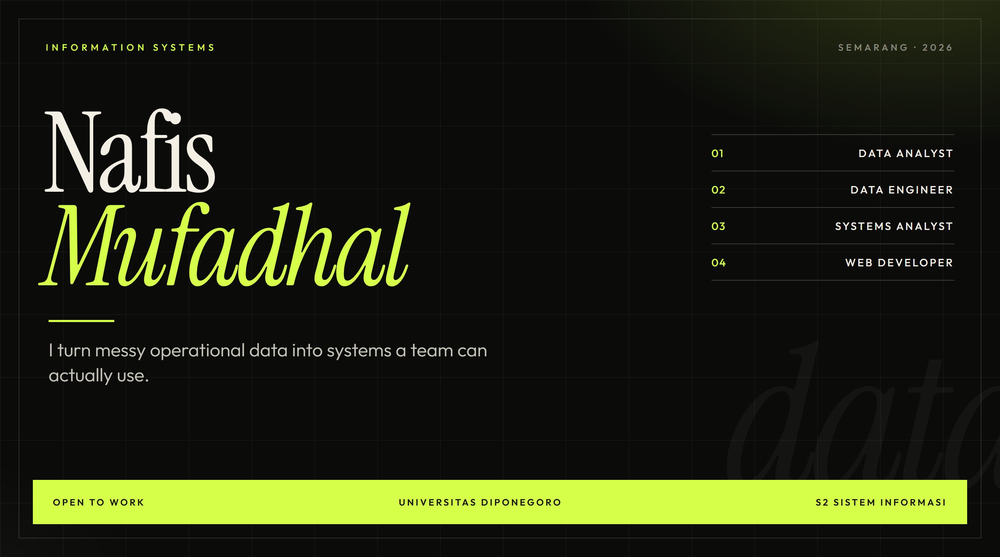
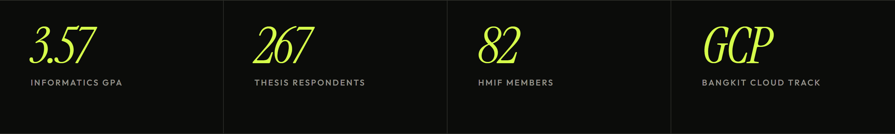
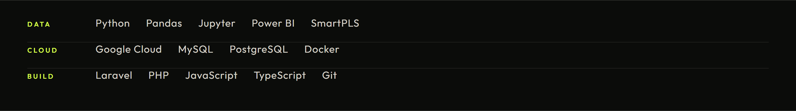

## Selected work

### 01 — Sistem Kependudukan Ampel

E-government system for population records. Laravel 12, MySQL, role-based access, GIS, QR verification, and an analytics dashboard.

[Open the repository](https://github.com/nafissmf/Sistem-Kependudukan-Ampel)

### 02 — Pencatatan Penduduk

Population registration and verification with barcodes, built with Laravel and PHP.

[Open the repository](https://github.com/nafissmf/Pencatatan-Penduduk-Barcode)

### 03 — RoDex

Mobile app that detects and reports road damage from photos, with location tagging.

[Open the repository](https://github.com/nafissmf/RoDex)

## In progress

Graduate study in Information Systems at Universitas Diponegoro, after Informatics Engineering. The thesis tests an integrated DeLone & McLean, UTAUT2, and Affordance model with PLS-SEM. The manuscript is submitted to JUTIF (SINTA 2).

Alongside that: Bangkit Academy with Google Cloud, cloud computing track, and chairing HMIF.

Open to roles in data analysis, data engineering, IT, project management, and operations.

[LinkedIn](https://www.linkedin.com/in/nafissmf) · [Email](mailto:nafismufadhal21@gmail.com) · [ORCID](https://orcid.org/0009-0003-3306-1512)
